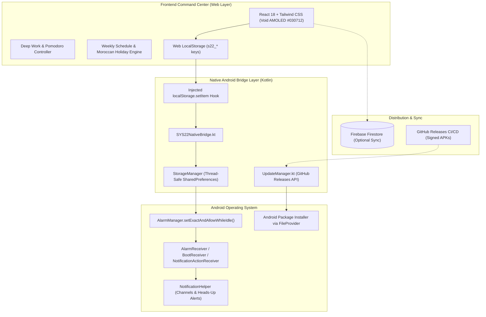

# SYS22: Elite Tactical Command & Academic Performance System

<div align="center">


**An ultra-focused tactical operating system and academic command center designed for rigorous discipline, circadian alignment, and high-performance study management.**

[Download Latest APK (v2.3.0)](https://github.com/Ayoubvvch/SYS22/releases/latest) • [Features](#-core-features) • [Architecture](#-system-architecture) • [Security & Privacy](#-security--privacy-architecture) • [Building From Source](#-building-from-source)

</div>

---

## ⚡ Overview

**SYS22 (SYSTEM 22)** is an offline-first, tactical command center engineered for intensive academic preparation (specifically tailored for the Moroccan National Baccalaureate - 2BAC Physical Sciences). It transforms a smartphone into a distraction-free, military-grade productivity terminal.

Built with a high-performance **Kotlin Native Android wrapper** hosting an offline **React + Tailwind CSS** single-page application via `WebViewAssetLoader`, SYS22 bridges web agility with native Android power—delivering background alarms, exact notification scheduling, interactive notification actions, and seamless in-app updates.

---

## 🚀 Core Features

### 1. 🎯 Precision Notification Engine (Decluttered & Tactical)
* **Daily Tactical Wisdom ("حكمة اليوم"):**
  * Automatically rotates through your personal **Rules (`s22_rules`)**, **Morning Protocol (`s22_morningRules`)**, and **Tactical Notes (`s22_patterns`)**.
  * Fires an inspiring tactical notification every morning at 7:00 AM with the Gojo icon, gold accent, and a quick acknowledgment action.
* **Essential Exam Alerts Only:**
  * **D-1 Reminder:** Fired 24 hours prior to crucial exams.
  * **T-30M Call-to-Action:** High-priority alert triggered exactly 30 minutes before exam commencement.
* **Exact Task Scheduling:**
  * Triggers notifications strictly at scheduled task hours (`HH:mm`) for the current day.
  * Filters out routine filler blocks and school timetables to eliminate notification noise.
* **Notification Hygiene:**
  * **Auto-Timeout:** Notifications automatically dismiss after 45 minutes to prevent notification drawer clutter.
  * **Interactive Quick Actions:** Built-in **Snooze (15 min)** and **Dismiss** buttons directly in the notification shade.
* **Reboot Resilience:** A native `BootReceiver` restores and reschedules all pending alarms after device restart.

### 2. 🇲🇦 Moroccan Academic Calendar Intelligence
* **Ministry Schedule Integration:** Pre-configured with the official Moroccan Ministry of National Education calendar (15 official vacation periods).
* **Automatic Routine Suppression:** During intermediate vacations (1st through 4th mid-term breaks, mid-year recess, religious & national holidays), all recurring school blocks are automatically suppressed.
* **Full Revision Mode:** Vacations automatically convert your daily schedule into full-day revision and deep study blocks.

### 3. 🧠 Deep Work & Circadian Rhythm HUD
* **Circadian Anchors:** Standardized high-discipline sleep/wake routine (default: **03:30 AM Wake / 20:30 PM Sleep**).
* **Energy Phase Tracking:** Visualizes cognitive peak hours, energy dips, afternoon recovery, and sleep preparation.
* **Pomodoro & Timeboxing:** Built-in focus timer with configurable work/break cycles, audio cues, and daily focus tracking (Target: **180+ minutes** of pure deep work).

### 4. 🔄 In-App OTA Update Engine
* **One-Click Update Checker:** A dedicated control panel in Settings connects directly to the GitHub Releases API.
* **Seamless Download & Install:**
  * Downloads APK updates with an in-app progress dialog.
  * Launches the Android Package Installer automatically via secure `FileProvider` and `REQUEST_INSTALL_PACKAGES`.
* **Zero Data Loss:** Permanent production keystore signing ensures future versions install over old ones without requiring app uninstallation.

### 5. 🛡️ Open-Source Security & Privacy Architecture
* **Zero Hardcoded Secrets:** No proprietary Firebase API keys or database tokens are baked into the repository.
* **First-Run Cloud Activation:** Prompts the user on first launch to supply their own Firebase Web API Key.
* **Local-First Storage:** Configuration and tokens remain strictly within local device storage (`localStorage` & `SharedPreferences`).
* **Offline-First Resilience:** Operates with 100% functionality without internet connection; syncs with Firebase Firestore when connected.

---

## 🏗️ System Architecture



---

## 📂 Repository Structure

```
SYS22/
├── .github/
│   └── workflows/
│       └── build-apk.yml           # Automated Java 17 CI/CD release workflow
├── app/
│   ├── build.gradle                # Android configuration, v2.2.0, signingConfigs
│   ├── sys22-release.jks           # Production release keystore (10,000 days validity)
│   └── src/
│       └── main/
│           ├── AndroidManifest.xml # Permissions, receivers, FileProvider setup
│           ├── assets/
│           │   └── web/            # Bundled offline React single-page application
│           │       ├── index.html
│           │       └── assets/
│           │           ├── sys22-core.js       # First-run modal & Update card injector
│           │           ├── index-*.js          # React frontend bundle
│           │           └── jetbrains-mono-*.ttf # Offline typography
│           ├── java/com/acmods/sys22/
│           │   ├── MainActivity.kt             # Hardware-accelerated WebView & Bridge
│           │   ├── bridge/SYS22NativeBridge.kt # JavaScript-to-Kotlin Bridge
│           │   ├── data/StorageManager.kt      # Native SharedPreferences manager
│           │   ├── model/DataModels.kt         # Data classes for tasks & targets
│           │   ├── notification/NotificationHelper.kt # Channels & heads-up alerts
│           │   ├── receiver/                   # Broadcast receivers (Alarm, Boot, Actions)
│           │   ├── scheduler/SYS22AlarmScheduler.kt  # AlarmManager exact scheduling
│           │   └── update/UpdateManager.kt     # OTA GitHub release downloader & installer
│           └── res/
│               └── xml/file_paths.xml          # Secure FileProvider paths
├── build.gradle                    # Project-level build script
├── settings.gradle                 # Gradle project settings
└── README.md                       # Complete documentation
```

---

## 🔒 Security & Privacy Architecture

| Component | Implementation |
| :--- | :--- |
| **API Key Storage** | User-provided at runtime via the First-Run Activation Modal; stored exclusively in local device storage. |
| **Asset Security** | Served via `WebViewAssetLoader` over `https://appassets.androidplatform.net/` to enforce secure origin isolation. |
| **App Signature** | Standard PKCS12 production keystore (`sys22-release.jks`) ensuring persistent cryptographic identity across all releases. |
| **Data Sovereignty** | Completely functional in pure offline mode. No telemetry, third-party analytics, or ad trackers. |

---

## 🛠️ Building From Source

### Prerequisites
* **JDK 17** (Temurin or OpenJDK recommended)
* **Android SDK 34** (Build-Tools 34.0.0, Platform API 34)
* **Git**

### Build Steps

1. **Clone the Repository:**
   ```bash
   git clone https://github.com/Ayoubvvch/SYS22.git
   cd SYS22
   ```

2. **Assemble Signed Release APK:**
   * **Linux / macOS:**
     ```bash
     chmod +x gradlew
     ./gradlew assembleRelease --stacktrace
     ```
   * **Windows:**
     ```powershell
     .\gradlew.bat assembleRelease --stacktrace
     ```

3. **Locate Generated APK:**
   ```
   app/build/outputs/apk/release/app-release.apk
   ```

---

## 📦 Releases & Versioning

Releases follow [Semantic Versioning](https://semver.org/). Every push to the `main` branch triggers the GitHub Actions pipeline to compile, sign, verify, and publish a standalone release APK:

* **Current Release:** [`v2.3.0`](https://github.com/Ayoubvvch/SYS22/releases/tag/v2.3.0)
* **Download:** [Direct APK Download](https://github.com/Ayoubvvch/SYS22/releases/download/v2.3.0/SYS22-v2.3.0.apk)

---

## 📄 License

This project is licensed under the [MIT License](LICENSE) — free and open for educational and personal productivity use.
